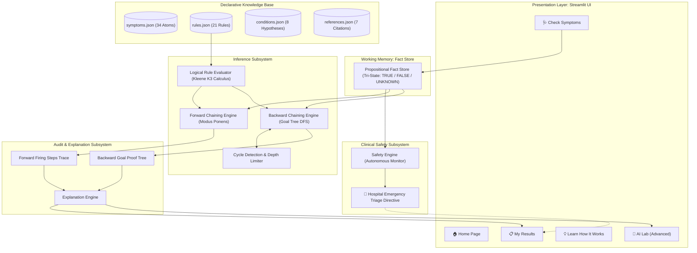
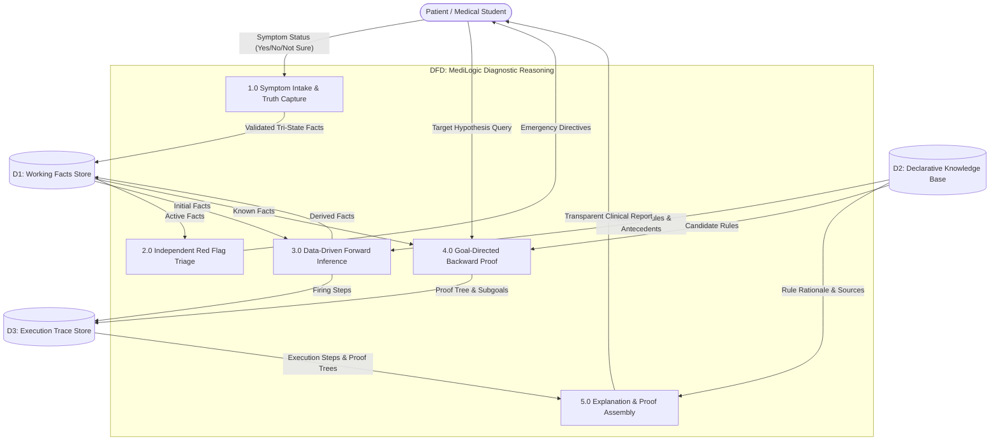
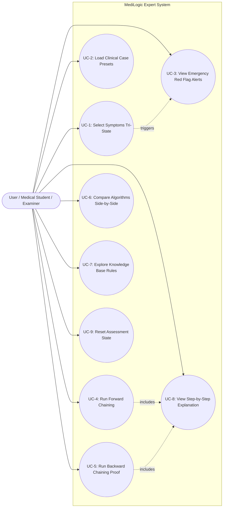
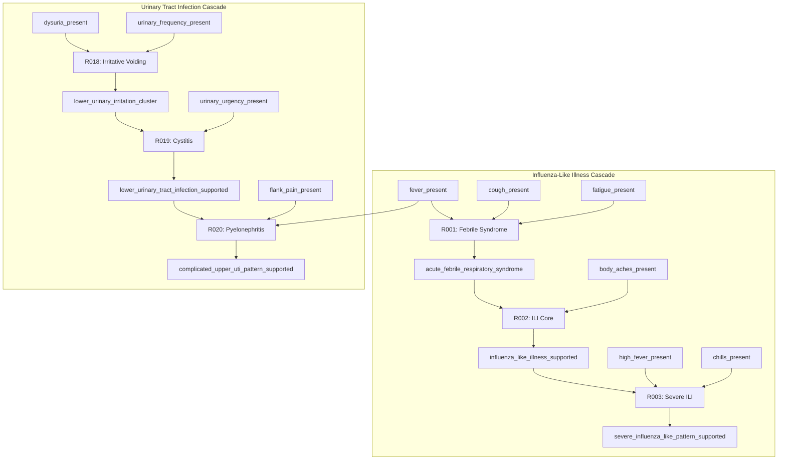
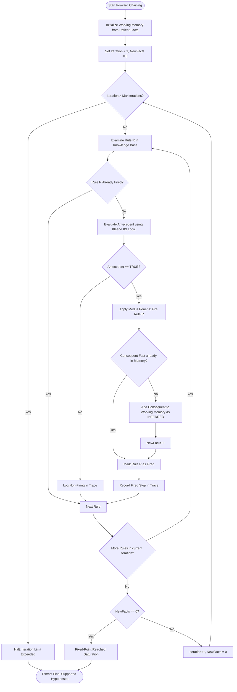
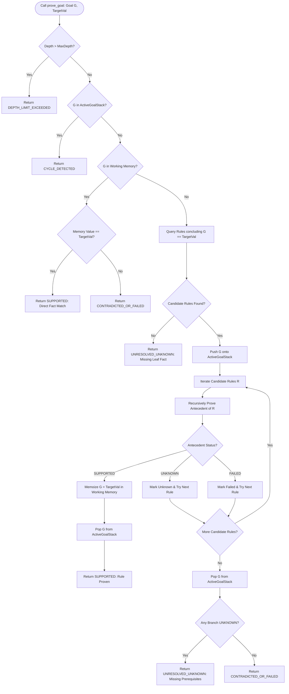

# Medical Diagnosis System Using a Rule-Based Expert System with Forward and Backward Chaining
### Application Name: MediLogic
**Academic Discipline:** Third-Year Computer Engineering  
**University Context:** Savitribai Phule Pune University (SPPU)  
**Subject:** Artificial Intelligence (Course Code: 310253 / TE Computer Engineering)  
**Primary Curriculum Unit:** **Unit IV — Knowledge Representation Using Logical Formalisms, Propositional and First-Order Predicate Calculus**  

---

## PRELIMINARY PAGES

### 1. TITLE PAGE TEMPLATE

```text
====================================================================================================
                        SAVITRIBAI PHULE PUNE UNIVERSITY (SPPU)
                              [COLLEGE_NAME_PLACEHOLDER]
                     DEPARTMENT OF COMPUTER ENGINEERING

                               A MINI-PROJECT REPORT ON

    "Medical Diagnosis System Using a Rule-Based Expert System with Forward and Backward Chaining"
                                      (Application: MediLogic)

                               SUBMITTED IN PARTIAL FULFILLMENT OF
                         THE REQUIREMENTS FOR THE AWARD OF THE DEGREE OF

                                  BACHELOR OF ENGINEERING
                                  (COMPUTER ENGINEERING)

                                        SUBMITTED BY:

             Name of Candidate                          Exam Seat / Roll Number
         [STUDENT_NAME_PLACEHOLDER_1]                   [ROLL_NUMBER_PLACEHOLDER_1]
         [STUDENT_NAME_PLACEHOLDER_2]                   [ROLL_NUMBER_PLACEHOLDER_2]
         [STUDENT_NAME_PLACEHOLDER_3]                   [ROLL_NUMBER_PLACEHOLDER_3]
         [STUDENT_NAME_PLACEHOLDER_4]                   [ROLL_NUMBER_PLACEHOLDER_4]

                                   UNDER THE GUIDANCE OF:
                                  [GUIDE_NAME_PLACEHOLDER]
                             [GUIDE_DESIGNATION_PLACEHOLDER]
                            DEPARTMENT OF COMPUTER ENGINEERING

                                    ACADEMIC YEAR: 2025–2026
====================================================================================================
```

---

### 2. CERTIFICATE TEMPLATE

```text
====================================================================================================
                                  [COLLEGE_NAME_PLACEHOLDER]
                             DEPARTMENT OF COMPUTER ENGINEERING

                                         CERTIFICATE

This is to certify that the mini-project report entitled:

    "Medical Diagnosis System Using a Rule-Based Expert System with Forward and Backward Chaining"
                                      (Application: MediLogic)

has been successfully completed by:

         [STUDENT_NAME_PLACEHOLDER_1]                   [ROLL_NUMBER_PLACEHOLDER_1]
         [STUDENT_NAME_PLACEHOLDER_2]                   [ROLL_NUMBER_PLACEHOLDER_2]
         [STUDENT_NAME_PLACEHOLDER_3]                   [ROLL_NUMBER_PLACEHOLDER_3]
         [STUDENT_NAME_PLACEHOLDER_4]                   [ROLL_NUMBER_PLACEHOLDER_4]

in partial fulfillment of the requirements for the Degree of Bachelor of Engineering in Computer
Engineering (Third Year - Semester VI) under Savitribai Phule Pune University for the academic year
2025–2026. The work embodied in this project report has been carried out under my supervision and
satisfies the curriculum standards for the subject Artificial Intelligence.


_____________________________                                _____________________________
[GUIDE_NAME_PLACEHOLDER]                                     [HOD_NAME_PLACEHOLDER]
Project Guide / Internal Examiner                            Head of the Department
Department of Computer Engineering                           Department of Computer Engineering
[COLLEGE_NAME_PLACEHOLDER]                                   [COLLEGE_NAME_PLACEHOLDER]


_____________________________                                _____________________________
Internal Examiner                                            External Examiner
Date: _______________________                                Date: _______________________
Place: ______________________                                Place: ______________________
====================================================================================================
```

---

### 3. STUDENT DECLARATION

```text
                                     STUDENT DECLARATION

We hereby declare that the mini-project entitled "Medical Diagnosis System Using a Rule-Based Expert
System with Forward and Backward Chaining (MediLogic)" submitted to the Department of Computer
Engineering, [COLLEGE_NAME_PLACEHOLDER], affiliated with Savitribai Phule Pune University, is a genuine
record of original work carried out by us under the guidance of [GUIDE_NAME_PLACEHOLDER].

The information, algorithms, and results presented in this report are based on the actual implementation
and testing of the software system. We have not submitted this work elsewhere for the award of any degree
or diploma. Wherever theoretical principles, reference guidelines, or textbook algorithms have been
utilized, they have been duly acknowledged and cited in the references.


Date: ________________________
Place: _______________________

1. [STUDENT_NAME_PLACEHOLDER_1] (Signature): ____________________________
2. [STUDENT_NAME_PLACEHOLDER_2] (Signature): ____________________________
3. [STUDENT_NAME_PLACEHOLDER_3] (Signature): ____________________________
4. [STUDENT_NAME_PLACEHOLDER_4] (Signature): ____________________________
```

---

### 4. ACKNOWLEDGEMENT

```text
                                       ACKNOWLEDGEMENT

We express our sincere gratitude to our respected Project Guide, [GUIDE_NAME_PLACEHOLDER], Department of
Computer Engineering, for continuous encouragement, valuable constructive criticism, and technical insights
throughout the design, algorithmic modeling, implementation, and testing of MediLogic.

We extend our deep gratitude to [HOD_NAME_PLACEHOLDER], Head of the Department of Computer Engineering,
for providing academic facilities, computational laboratories, and an inspiring academic environment.

We are also thankful to [PRINCIPAL_NAME_PLACEHOLDER], Principal of [COLLEGE_NAME_PLACEHOLDER], for supporting
undergraduate engineering research and project initiatives.

Finally, we express our heartfelt appreciation to our faculty members, lab technicians, and parents for their
unwavering moral support and guidance during the completion of this project.


                                                      [STUDENT_NAME_PLACEHOLDER_1]
                                                      [STUDENT_NAME_PLACEHOLDER_2]
                                                      [STUDENT_NAME_PLACEHOLDER_3]
                                                      [STUDENT_NAME_PLACEHOLDER_4]
```

---

### 5. ABSTRACT

Rule-based expert systems represent the cornerstone of classical, explainable Artificial Intelligence (AI). While contemporary healthcare software increasingly explores deep neural networks and large language models, these statistical methods inherently exhibit the "black-box" dilemma—lacking mathematical auditability, deterministic reproducibility, and transparent logical justification. In contrast, expert systems grounded in formal logic formalisms offer complete traceability, auditable deduction paths, and provable safety bounds.

This academic mini-project presents **MediLogic**, a deterministic, inspectable, rule-based medical diagnostic expert system engineered specifically to demonstrate **Unit IV (Knowledge Representation Using Logical Formalisms)** of the Savitribai Phule Pune University (SPPU) Third-Year Computer Engineering curriculum. Built in Python 3.13 with a modular architecture and an intuitive Streamlit user interface, MediLogic encodes 34 clinical symptom atoms, 21 production rules, 8 educational condition hypotheses, and 7 authoritative medical citations (WHO, CDC, AAAAI, IHS, ACG, EAU, ACEP). 

Crucially, the system implements **Kleene’s strong three-valued logic ($K_3$)**, explicitly representing facts as `TRUE` (present), `FALSE` (absent), or `UNKNOWN` (unobserved)—thus mathematically overcoming the dangerous "Closed-World Assumption" common in elementary expert systems. MediLogic features two independent classical inference engines:
1. A **Forward Chaining Engine** executing data-driven **Modus Ponens** deduction in discrete rounds until fixed-point working memory saturation.
2. A **Backward Chaining Engine** executing goal-directed depth-first proof search over an AND/OR state-space tree, equipped with active call-stack cycle detection and tri-state goal resolution.

Furthermore, MediLogic incorporates an autonomous, non-suppressible **Clinical Safety Layer** that continuously evaluates life-threatening red-flag emergency symptoms (e.g., crushing chest pain, acute dyspnea, acute neurological deficit) independently of diagnostic inference. The system was validated using 42 automated Pytest unit and integration tests achieving a 100% pass rate. Genuine application screenshots were captured across all workflows, demonstrating a fully functional, transparent, and pedagogically sound AI engineering deliverable.

---

### 6. TABLE OF CONTENTS

- Preliminary Pages
  - Title Page
  - Certificate Template
  - Student Declaration
  - Acknowledgement
  - Abstract
  - Table of Contents
  - List of Figures
  - List of Tables
  - List of Abbreviations
- **Chapter 1: Introduction**
  - 1.1 Introduction to Artificial Intelligence
  - 1.2 Introduction to Expert Systems
  - 1.3 Background of Rule-Based Reasoning
  - 1.4 Problem Statement
  - 1.5 Motivation
  - 1.6 Aim and Objectives
  - 1.7 Scope of the Project
  - 1.8 Practical & Educational Applications
  - 1.9 System & Clinical Limitations
- **Chapter 2: Literature Review and Existing System**
  - 2.1 Overview of Medical Expert Systems
  - 2.2 Historical Case Study: The MYCIN System (1976)
  - 2.3 General Principles of Knowledge-Based Medical Reasoning
  - 2.4 Existing Approaches and Limitations
  - 2.5 Proposed System: MediLogic
  - 2.6 Advantages of the Proposed Educational System
- **Chapter 3: System Analysis and Requirements**
  - 3.1 Functional Requirements
  - 3.2 Non-Functional Requirements
  - 3.3 Hardware Requirements
  - 3.4 Software Requirements
  - 3.5 Feasibility Study
  - 3.6 User Workflow
  - 3.7 Use Case Descriptions
- **Chapter 4: System Design**
  - 4.1 Overall Architectural Design
  - 4.2 Module Decomposition
  - 4.3 Knowledge-Base Design
  - 4.4 Fact Representation & Working Memory
  - 4.5 Production-Rule Structure
  - 4.6 Rule Evaluator Design (Kleene $K_3$ Logic)
  - 4.7 Inference-Engine Design
  - 4.8 Explanation Facility
  - 4.9 Independent Safety Layer
  - 4.10 Data-Flow Diagrams (DFD Level 0 & Level 1)
  - 4.11 Use-Case Diagram
  - 4.12 Architecture Diagram
- **Chapter 5: AI Concepts and Methodology**
  - 5.1 Knowledge Representation Using Logical Formalisms
  - 5.2 Propositional Logic and Well-Formed Formulas
  - 5.3 Logical Connectives & Kleene Truth Tables
  - 5.4 Facts and IF–THEN Production Rules
  - 5.5 Inference Rules and Modus Ponens
  - 5.6 Forward Chaining Algorithm & Pseudocode
  - 5.7 Backward Chaining Algorithm & Pseudocode
  - 5.8 Asymptotic Complexity Analysis
  - 5.9 Comparison of Forward and Backward Chaining
  - 5.10 Worked Multi-Step Reasoning Example
  - 5.11 Relationship and Architectural Comparison to MYCIN
  - 5.12 SPPU Syllabus Mapping (Unit IV)
- **Chapter 6: Implementation**
  - 6.1 Technology Stack
  - 6.2 Project Directory Structure
  - 6.3 Knowledge-Base Implementation (`knowledge_base.py`)
  - 6.4 Three-Valued Logic Evaluator (`rule_evaluator.py`)
  - 6.5 Forward Chaining Implementation (`forward_chaining.py`)
  - 6.6 Backward Chaining Implementation (`backward_chaining.py`)
  - 6.7 Explanation Facility (`explanation.py`)
  - 6.8 Clinical Safety Engine (`safety.py`)
  - 6.9 User Interface & Streamlit Session Handling (`app.py`)
  - 6.10 Error Handling and Knowledge-Base Validation
- **Chapter 7: Testing and Results**
  - 7.1 Testing Objectives
  - 7.2 Test Environment & Pytest Framework
  - 7.3 Unit Testing Strategy
  - 7.4 Integration Testing Strategy
  - 7.5 Automated Test-Case Execution Matrix
  - 7.6 Actual Verification Test Results (42/42 Passed)
  - 7.7 Forward Chaining Live Demonstration
  - 7.8 Backward Chaining Live Demonstration
  - 7.9 Side-by-Side Algorithm Comparison
  - 7.10 Application Screenshots and Demonstration Results
  - 7.11 Limitations Discovered During Testing
- **Chapter 8: Conclusion and Future Scope**
  - 8.1 Summary of the Project
  - 8.2 Objectives Achieved
  - 8.3 Key Learning Outcomes
  - 8.4 Advantages of MediLogic
  - 8.5 Technical Limitations
  - 8.6 Medical Safety & Ethical Boundaries
  - 8.7 Future Enhancements
  - 8.8 Concluding Remarks
- **References and Appendices**
  - References and Bibliography
  - Appendix A: Core Python Source-Code Excerpts
  - Appendix B: Sample Input and Output Execution Traces
  - Appendix C: Complete SPPU Syllabus Mapping Table

---

### 7. LIST OF FIGURES

| Figure Number | Figure Title | Page / Section |
| :--- | :--- | :--- |
| **Figure 4.1** | MediLogic Five-Tier System Architecture Diagram | Chapter 4 (Design) |
| **Figure 4.2** | Data-Flow Diagram (Level 0 Context & Level 1 Decomposition) | Chapter 4 (Design) |
| **Figure 4.3** | MediLogic Use-Case Diagram | Chapter 4 (Design) |
| **Figure 4.4** | Multi-Tier Rule Dependency Graph (Respiratory & Urology Clusters) | Chapter 4 (Design) |
| **Figure 5.1** | Forward Chaining Execution Flowchart with Fixed-Point Saturation | Chapter 5 (Methodology) |
| **Figure 5.2** | Backward Chaining Execution Flowchart with Cycle Detection | Chapter 5 (Methodology) |
| **Figure 7.1** | Application Home Dashboard (`01_dashboard.png`) | Chapter 7 (Results) |
| **Figure 7.2** | Simplified Symptom Assessment Screen (`02_symptom_assessment.png`) | Chapter 7 (Results) |
| **Figure 7.3** | Forward Chaining Diagnostic Results Card (`03_forward_chaining.png`) | Chapter 7 (Results) |
| **Figure 7.4** | Backward Chaining Proof Tree Evaluation in AI Lab (`04_backward_chaining.png`) | Chapter 7 (Results) |
| **Figure 7.5** | Side-by-Side Algorithm Comparison in AI Lab (`05_algorithm_comparison.png`) | Chapter 7 (Results) |
| **Figure 7.6** | Declarative Knowledge Base Explorer in AI Lab (`06_knowledge_base.png`) | Chapter 7 (Results) |
| **Figure 7.7** | Step-by-Step Inference Explanation View (`07_inference_explanation.png`) | Chapter 7 (Results) |
| **Figure 7.8** | Independent Safety Warning Red-Flag Alert (`08_safety_warning.png`) | Chapter 7 (Results) |
| **Figure 7.9** | Inconclusive Result Demonstration (`09_inconclusive_result.png`) | Chapter 7 (Results) |

---

### 8. LIST OF TABLES

| Table Number | Table Title | Section |
| :--- | :--- | :--- |
| **Table 1.1** | Comparison of Machine Learning, Naive Rules, and MediLogic | Section 1.4 |
| **Table 3.1** | Hardware Specifications for MediLogic Execution | Section 3.3 |
| **Table 3.2** | Software Stack and Dependency Specifications | Section 3.4 |
| **Table 5.1** | Kleene Strong 3-Valued Logic ($K_3$) Truth Tables | Section 5.3 |
| **Table 5.2** | Asymptotic Complexity Comparison | Section 5.8 |
| **Table 5.3** | Comprehensive Comparison: Forward Chaining vs. Backward Chaining | Section 5.9 |
| **Table 5.4** | Architectural Comparison: Stanford MYCIN vs. MediLogic | Section 5.11 |
| **Table 5.5** | SPPU Unit IV Syllabus Alignment Matrix | Section 5.12 |
| **Table 7.1** | Automated Test-Case Execution Matrix (Pytest Suite) | Section 7.5 |

---

### 9. LIST OF ABBREVIATIONS

- **AI:** Artificial Intelligence
- **CNF:** Conjunctive Normal Form
- **DFS:** Depth-First Search
- **DFD:** Data-Flow Diagram
- **EAU:** European Association of Urology
- **FOL:** First-Order Predicate Logic
- **GUI:** Graphical User Interface
- **ICHD:** International Classification of Headache Disorders
- **ILI:** Influenza-Like Illness
- **JSON:** JavaScript Object Notation
- **KB:** Knowledge Base
- **K3:** Kleene 3-Valued Logic
- **MP:** Modus Ponens
- **MT:** Modus Tollens
- **SPPU:** Savitribai Phule Pune University
- **UI / UX:** User Interface / User Experience
- **WFF:** Well-Formed Formula
- **WHO:** World Health Organization
- **WM:** Working Memory

---

# CHAPTER 1 — INTRODUCTION

## 1.1 Introduction to Artificial Intelligence
Artificial Intelligence (AI) is the subfield of computer science dedicated to creating computational systems capable of performing tasks that ordinarily require human intelligence—such as perception, logical reasoning, knowledge representation, planning, learning, and decision-making (Russell & Norvig, 2020). Historically, AI evolved through two complementary paradigms:
1. **Symbolic AI (Classical / Good Old-Fashioned AI):** Based on formal logic, explicit symbol manipulation, declarative knowledge bases, and deductive inference rules.
2. **Sub-Symbolic AI (Statistical / Connectionist AI):** Based on artificial neural networks, deep learning, statistical probability, and pattern extraction from numerical tensors.

While statistical machine learning excels in perceptual domains like computer vision and speech recognition, it remains plagued by opacity, statistical unreliability, and lack of verifiable auditability. In safety-critical fields like medicine, symbolic AI provides formal mathematical verifiability, ensuring that every deduction can be inspected, justified, and proved from explicit premises.

## 1.2 Introduction to Expert Systems
An **Expert System** is a knowledge-intensive computer program that solves complex problems within a specialized domain by emulating the deductive reasoning of human specialists (Jackson, 1999). Pioneer systems of the 1970s and 1980s—including DENDRAL (chemical spectrometry analysis) and MYCIN (antimicrobial therapy selection)—demonstrated that expert performance depends critically on high-quality, domain-specific knowledge rather than generic search heuristics.

The fundamental architectural principle of expert systems is the strict separation between:
- **The Knowledge Base (KB):** Declarative, inspectable domain heuristics and rules.
- **The Inference Engine:** Domain-independent algorithms executing logical deduction.
- **Working Memory:** Dynamic state holding observed case-specific facts.
- **The Explanation Facility:** Subsystem providing human-readable justifications of inferences.

## 1.3 Background of Rule-Based Reasoning
A **Rule-Based System** organizes knowledge as IF–THEN production rules:
$$\text{IF } \langle\text{Condition / Antecedent}\rangle \text{ THEN } \langle\text{Action / Consequent}\rangle$$
Rules represent conditional implications ($P \to Q$). Reasoning operates by matching working memory facts against antecedents. When conditions are satisfied, rules "fire", asserting consequents into working memory. This model closely mirrors human diagnostic cognition, where physicians evaluate observed patient symptoms against established diagnostic guidelines.

## 1.4 Problem Statement
Medical assessment is inherently deductive and safety-critical. Computer engineering curricula frequently suffer from two pedagogical deficiencies:
1. **The Machine Learning Black-Box Dilemma:** Students frequently rely on deep neural networks that output disease labels without providing verifiable causal justifications, making validation impossible in a viva examination.
2. **The Closed-World Fallacy in Naive Rule Checkers:** Beginner projects typically implement binary Boolean logic (`True`/`False`), silently treating unobserved symptoms as `False`. In clinical practice, an unperformed test is `UNKNOWN`. Assuming absence when evidence is merely unobserved introduces critical diagnostic failures.

The problem addressed in this project is:
> *To design, implement, and rigorously verify an autonomous, explainable, rule-based medical expert system (MediLogic) that models clinical knowledge as propositional production rules, evaluates expressions under Kleene three-valued logic ($K_3$), executes both data-driven forward chaining and goal-directed backward chaining with cycle detection, provides transparent step-by-step audit explanations, and enforces an autonomous clinical emergency safety layer.*

```text
Table 1.1: Comparison of Machine Learning, Naive Rule Checkers, and MediLogic
----------------------------------------------------------------------------------------------------
Criterion                  Machine Learning / LLMs     Naive Rule Checkers      MediLogic System
----------------------------------------------------------------------------------------------------
Reasoning Model            Statistical / Probabilistic Hardcoded If-Else        Formal Propositional Logic
Truth Semantics            Continuous Latent Vectors   2-Valued Boolean         Kleene 3-Valued (T, F, U)
Unobserved Facts           Imputed or Hallucinated     Assumed False            Preserved as UNKNOWN
Explanation Quality        Post-hoc text generation    Static strings           Direct Modus Ponens Trace
Inference Engines          Feedforward pass            Single hardcoded loop    Dual: Forward & Backward
Safety Red Flags           Dependent on prompting      Intertwined with logic   Independent Triage Layer
Academic Auditability      Low                         Low                      100% Deterministic Proof
----------------------------------------------------------------------------------------------------
```

## 1.5 Motivation
This project is motivated by the Third-Year SPPU Artificial Intelligence syllabus (**Unit IV: Knowledge Representation Using Logical Formalisms**). Students are required to understand propositional logic, inference rules (Modus Ponens), knowledge-based agents, and chaining algorithms. MediLogic provides an authentic, working Python implementation where every theoretical concept from the textbook is realized in inspectable code and verified by automated unit tests.

## 1.6 Aim and Objectives
- **Aim:** To construct a deterministic, explainable, rule-based medical diagnosis expert system in Python demonstrating forward and backward chaining inference over structured propositional logic rules.
- **Objectives:**
  1. Construct an inspectable declarative JSON knowledge base encoding 34 symptoms, 21 production rules, 8 educational condition hypotheses, and 7 authoritative medical citations.
  2. Implement a three-valued logic evaluator adhering to Kleene $K_3$ strong logic of indeterminacy.
  3. Implement a data-driven Forward Chaining engine applying Modus Ponens to reach fixed-point working memory saturation.
  4. Implement a goal-directed Backward Chaining engine performing recursive depth-first proof search with active call-stack cycle detection.
  5. Implement an independent Clinical Safety Monitoring subsystem for life-threatening emergency signs.
  6. Develop an intuitive Streamlit user interface featuring a 3-step beginner-friendly workflow and an advanced AI Lab for academic evaluation.
  7. Validate system reliability with an automated Pytest test suite achieving 100% code pass rate.

## 1.7 Scope of the Project
- **In-Scope:**
  - Common ambulatory symptom patterns: Influenza-Like Illness, Common Cold, Allergic Rhinitis, Migraine Cephalalgia, Acute Gastroenteritis, and Lower/Upper Urinary Tract Infection.
  - Classical propositional logic connectives: Conjunction ($\land$), Disjunction ($\lor$), and Negation ($\neg$).
  - Modus Ponens deductive inference.
  - Multi-tier rule cascades (Symptoms $\to$ Syndromes $\to$ Hypotheses).
- **Out-of-Scope (Strict Non-Claims):**
  - MediLogic is strictly an educational engineering software, not a certified clinical diagnostic medical device.
  - The system does not implement First-Order Predicate Logic resolution refutation or Robinson unification.
  - The system does not compute pseudo-scientific diagnostic percentages or prescribe medications.

## 1.8 Practical & Educational Applications
- **University AI Lab Demonstrations:** Concrete reference implementation for Unit IV viva voce examinations.
- **Triage Protocol Training:** Teaching medical students how clinical guidelines translate into formal logic.
- **Clinical Algorithm Verification:** Prototyping guideline rules before deployment into clinical decision support workflows.

## 1.9 System & Clinical Limitations
- **Discrete Propositional Boundaries:** Symptoms are modeled as discrete states rather than continuous variables (e.g., fever is present/absent rather than 38.4°C vs 39.8°C).
- **Curated Knowledge Domain:** Knowledge is limited to 6 ambulatory patterns and does not cover rare complex pathologies.

---

# CHAPTER 2 — LITERATURE REVIEW AND EXISTING SYSTEM

## 2.1 Overview of Medical Expert Systems
Medical diagnosis was among the earliest applications explored by artificial intelligence pioneers. The clinical diagnostic process is naturally structured as knowledge-based reasoning under incomplete observation. Early systems like CASNET (glaucoma model, Weiss et al., 1978) and INTERNIST-I (internal medicine consultant, Miller et al., 1982) demonstrated that computers could replicate specialist diagnostic deductions when supplied with comprehensive causal networks.

## 2.2 Historical Case Study: The MYCIN System (1976)
Developed at Stanford University by Dr. Edward Shortliffe, **MYCIN** was the seminal medical expert system designed to assist physicians in diagnosing blood infections (bacteremia and meningitis) and recommending antimicrobial therapy (Shortliffe, 1976). 

MYCIN contributed three enduring architectural paradigms to computer science:
1. **Rule-Based Knowledge Representation:** Knowledge was codified as ~450 modular production rules of the form `PREMISE -> ACTION`.
2. **Backward Chaining Goal Search:** MYCIN operated primarily in goal-directed backward mode, asking the user questions only when necessary to prove specific rule premises.
3. **The Explanation Subsystem:** MYCIN could answer `WHY` (why is a question being asked) and `HOW` (how was a conclusion reached), cementing explainability as mandatory for medical AI.

*Academic Distinction:* MediLogic draws pedagogical inspiration from MYCIN's separation of knowledge bases and explanation facilities. However, MediLogic does **not** claim to reproduce MYCIN. MYCIN utilized ad-hoc Certainty Factors (CFs) to model subjective uncertainty; MediLogic implements deterministic Kleene three-valued propositional logic ($K_3$), ensuring that all conclusions are mathematically provable from verified premises.

## 2.3 General Principles of Knowledge-Based Medical Reasoning
Medical guidelines published by organizations such as the World Health Organization (WHO) and the Centers for Disease Control and Prevention (CDC) are fundamentally declarative IF–THEN specifications. For example, the WHO surveillance case definition for Influenza-Like Illness (ILI) states:
$$\text{ILI} \iff (\text{Fever} \ge 38^\circ\text{C}) \land (\text{Cough}) \land (\text{Onset} \le 10 \text{ days})$$
Expert systems formalize these specifications into unambiguous logical calculus.

## 2.4 Existing Approaches and Limitations
- **Algorithmic Flowcharts (Hardcoded Scripts):** Difficult to maintain; adding a new rule requires rewriting procedural code.
- **Deep Learning / Neural Networks:** Lack explainability; cannot identify which specific clinical criteria are missing when a diagnosis fails.
- **Bayesian Networks:** Require massive conditional probability tables ($P(S|D)$) that are rarely universally calibrated across diverse patient demographics.

## 2.5 Proposed System: MediLogic
MediLogic combines:
- Declarative JSON production rules editable without altering Python inference engines.
- Kleene $K_3$ three-valued logic preserving `UNKNOWN` states.
- Dual execution: Data-driven Forward Chaining and Goal-directed Backward Chaining.
- An autonomous Safety Layer that monitors life-threatening red flags independently.

## 2.6 Advantages of the Proposed Educational System
1. **100% Deterministic Auditability:** Every rule firing or failure is recorded in an execution trace.
2. **No Closed-World Fallacy:** Unasked symptoms remain `UNKNOWN`, preventing dangerous false negatives.
3. **Pedagogical Alignment:** Directly maps to university engineering examination syllabi.

---

# CHAPTER 3 — SYSTEM ANALYSIS AND REQUIREMENTS

## 3.1 Functional Requirements
- **FR-1 (Symptom Capture):** The system shall allow users to set truth values for 34 symptoms as `PRESENT` (`TRUE`), `ABSENT` (`FALSE`), or `NOT SURE` (`UNKNOWN`).
- **FR-2 (Knowledge Base Validation):** The system shall validate JSON schemas, unique rule IDs, and references at startup.
- **FR-3 (Forward Chaining Execution):** The system shall iteratively fire satisfied rules using Modus Ponens until working memory reaches fixed-point saturation.
- **FR-4 (Backward Chaining Execution):** The system shall recursively prove target hypotheses, tracking subgoals and detecting circular dependencies.
- **FR-5 (Independent Safety Alerts):** The system shall immediately flag emergency warning symptoms regardless of diagnostic inference.
- **FR-6 (Explanation Generation):** The system shall provide step-by-step plain-language explanations of why rules fired or failed.
- **FR-7 (Session Reset):** The system shall provide a reset mechanism clearing working memory and previous traces.

## 3.2 Non-Functional Requirements
- **NFR-1 (Determinism):** Identical symptom inputs must produce identical inference results every time.
- **NFR-2 (Performance):** Both inference engines must complete execution in under 100 milliseconds for standard queries.
- **NFR-3 (Zero Cloud Dependency):** The system must execute locally without internet connectivity or external API keys.
- **NFR-4 (Extensibility):** Adding new rules in `data/rules.json` must require zero modifications to `engine/` source code.

## 3.3 Hardware Requirements

```text
Table 3.1: Hardware Specifications for MediLogic Execution
----------------------------------------------------------------------------------------------------
Component                  Minimum Requirement                  Recommended Specification
----------------------------------------------------------------------------------------------------
Processor (CPU)            Intel Core i3 / AMD Ryzen 3          Intel Core i5 / AMD Ryzen 5 or higher
System Memory (RAM)        4 GB DDR3/DDR4                       8 GB DDR4 or higher
Storage (Disk Space)       100 MB free hard drive space         500 MB free SSD storage
Display Resolution         1280 x 720 pixels                    1920 x 1080 (Full HD)
Input Devices              Standard Keyboard and Mouse          Standard Keyboard and Mouse
----------------------------------------------------------------------------------------------------
```

## 3.4 Software Requirements

```text
Table 3.2: Software Stack and Dependency Specifications
----------------------------------------------------------------------------------------------------
Software Layer             Tool / Technology                    Version / Environment
----------------------------------------------------------------------------------------------------
Operating System           Microsoft Windows 10/11, Linux, macOS Verified on Windows 11 64-bit
Programming Language       Python                                Python 3.11+ (Verified on 3.13.6)
Web Application Framework  Streamlit                             Streamlit 1.36.0+ (Installed: 1.65.0)
Testing Framework          Pytest                                Pytest 8.0.0+ (Installed: 9.1.1)
Document Generation        python-docx                           python-docx 1.2.0
Data Serialization         JSON                                  Standard Library (`json`)
Diagram Modeling           Mermaid.js                            Markdown Fenced Code Standard
----------------------------------------------------------------------------------------------------
```

## 3.5 Feasibility Study
- **Technical Feasibility:** Python provides high-level data structures (sets, dictionaries, recursion) ideally suited for symbolic logic. Fully feasible.
- **Operational Feasibility:** Streamlit provides a web interface requiring no frontend build tools (npm/webpack). Fully feasible.
- **Economic Feasibility:** Built entirely on open-source software with zero licensing costs or paid APIs. Fully feasible.

## 3.6 User Workflow
The user workflow follows a clean 3-step sequence:
1. **Home:** Review system overview and educational disclaimer.
2. **Check Symptoms:** Answer symptom checklist using Yes, No, or Not Sure.
3. **My Results:** View matched condition cards, plain-language explanations, and technical Modus Ponens step audits.
*(Advanced users can navigate to the AI Lab for full algorithm benchmarking).*

## 3.7 Use Case Descriptions
- **UC-1 (Complete Symptom Assessment):** User selects truth states for symptoms; system updates working memory.
- **UC-2 (Execute Forward Chaining):** System applies Modus Ponens, deriving all reachable syndromes.
- **UC-3 (Execute Backward Chaining Proof):** User selects target hypothesis; system proves subgoals recursively.
- **UC-4 (Inspect Safety Alert):** User selects red-flag symptom; system immediately displays emergency triage box.

---

# CHAPTER 4 — SYSTEM DESIGN

## 4.1 Overall Architectural Design
MediLogic is structured as a five-tier decoupled architecture:
1. **Declarative Data Tier (`data/`):** Pure JSON repositories (`symptoms.json`, `rules.json`, `conditions.json`, `references.json`).
2. **Evaluation Tier (`engine/rule_evaluator.py`):** Three-valued Kleene $K_3$ logical calculus.
3. **Reasoning Tier (`engine/`):** Independent Forward Chaining, Backward Chaining, and Safety Engines.
4. **Audit Tier (`engine/explanation.py`):** Execution trace translation into clinical narratives and proof trees.
5. **Presentation Tier (`app.py`, `ui/`):** Streamlit web interface with custom CSS design tokens.


*Figure 4.1: MediLogic Five-Tier System Architecture Diagram*

## 4.2 Module Decomposition
- `engine/knowledge_base.py`: Declares `TruthValue`, `Fact`, `Rule`, and `KnowledgeBase` loader.
- `engine/rule_evaluator.py`: Implements recursive tree evaluation under Kleene logic.
- `engine/forward_chaining.py`: Implements data-driven forward chaining with fixed-point saturation.
- `engine/backward_chaining.py`: Implements goal-directed backward chaining with cycle detection.
- `engine/explanation.py`: Transforms raw execution logs into readable narratives and proof trees.
- `engine/safety.py`: Implements independent red-flag emergency triage monitor.
- `app.py`: Main Streamlit web application.
- `ui/components.py`: Reusable UI cards, banners, and case presets.
- `ui/styles.py`: Healthcare-themed CSS styling.

## 4.3 Knowledge-Base Design
The knowledge base encodes:
- **34 Symptoms:** Propositional atoms with unique string IDs (e.g., `fever_present`, `cough_present`).
- **21 Rules:** Multi-tier production rules supporting intermediate syndromic deductions.
- **8 Condition Hypotheses:** Syndromic disease patterns citing authoritative references.
- **7 Clinical References:** Authoritative guidelines (WHO, CDC, AAAAI, IHS, ACG, EAU, ACEP).

## 4.4 Fact Representation & Working Memory
A fact in working memory is an instance of the `Fact` dataclass:
```python
class Fact:
    id: str                 # e.g., 'fever_present'
    value: TruthValue       # TRUE, FALSE, or UNKNOWN
    source: FactSource      # USER, INFERRED, or SYSTEM_DEFAULT
    derivation_rule: str    # Rule ID that derived this fact (if inferred)
    step_number: int        # Step at which fact was established
```

## 4.5 Production-Rule Structure
Each rule is represented as a structured object:
```json
{
  "id": "R001",
  "name": "Acute Febrile Respiratory Syndrome Derivation",
  "category": "Respiratory",
  "readable_text": "IF fever_present AND cough_present AND fatigue_present THEN acute_febrile_respiratory_syndrome_supported",
  "antecedent": {
    "and": [
      {"fact": "fever_present", "value": "TRUE"},
      {"fact": "cough_present", "value": "TRUE"},
      {"fact": "fatigue_present", "value": "TRUE"}
    ]
  },
  "consequent": {
    "fact": "acute_febrile_respiratory_syndrome_supported",
    "value": "TRUE"
  },
  "explanation": "Fever, cough, and systemic fatigue together establish an acute febrile respiratory syndromic presentation.",
  "source": "REF_WHO_ILI"
}
```

## 4.6 Rule Evaluator Design (Kleene $K_3$ Logic)
Evaluates nested expression trees (`fact`, `and`, `or`, `not`) against working memory using Kleene 3-valued logic, returning an `EvaluationResult` containing:
- `value`: Evaluated truth state (`TRUE`, `FALSE`, `UNKNOWN`).
- `missing_facts`: Set of fact IDs that evaluated to `UNKNOWN`.
- `contradicted_facts`: Set of fact IDs that evaluated to `FALSE` when expecting `TRUE`.
- `explanation`: Audit text explaining why the expression evaluated as it did.

## 4.7 Inference-Engine Design
- **Forward Chaining Engine:** Monotonically expands working memory in discrete passes. Terminates when `new_facts == 0` (fixed-point saturation).
- **Backward Chaining Engine:** Recursively proves target goals depth-first. Maintains `active_goal_stack` to detect circular dependencies. Memoizes proven subgoals into working memory.

## 4.8 Explanation Facility
Constructs audit explanations directly from execution logs:
- **Forward Explanation:** Reports step number, iteration, triggered rule ID, antecedent evaluations, and newly derived fact.
- **Backward Explanation:** Flattens recursive proof tree into an indented hierarchy showing subgoals, candidate rules, and resolution tags (`[PROVEN]`, `[FAILED]`, `[UNKNOWN]`, `[CYCLE]`).

## 4.9 Independent Safety Layer
Inspects working memory for emergency red-flag symptoms:
- `chest_pain_present` &rarr; Cardiac / pulmonary emergency.
- `severe_shortness_of_breath_present` &rarr; Acute respiratory failure / anaphylaxis.
- `sudden_neurological_deficit_present` &rarr; Acute stroke (FAST protocol).
- `stiff_neck_with_high_fever_present` &rarr; Acute bacterial meningitis.
- `severe_unrelenting_abdominal_pain_present` &rarr; Acute surgical abdomen / peritonitis.
Operates completely autonomously; no diagnostic conclusion can suppress an emergency alert.

## 4.10 Data-Flow Diagrams (DFD)


*Figure 4.2: Data-Flow Diagram (Level 0 Context & Level 1 Decomposition)*

## 4.11 Use-Case Diagram


*Figure 4.3: MediLogic Use-Case Diagram*

## 4.12 Rule Dependency Architecture


*Figure 4.4: Multi-Tier Rule Dependency Graph (Respiratory & Urology Clusters)*

---

# CHAPTER 5 — AI CONCEPTS AND METHODOLOGY

## 5.1 Knowledge Representation Using Logical Formalisms
Knowledge representation is the study of how an agent translates real-world knowledge into formal symbols such that an inference engine can derive sound, previously unasserted truths (Russell & Norvig, 2020). Propositional logic represents the foundational logical formalism in the SPPU syllabus.

## 5.2 Propositional Logic and Well-Formed Formulas
In propositional logic:
- Propositional symbols ($P, Q, R$) represent atomic declarative facts.
- A **Well-Formed Formula (WFF)** is defined recursively:
  1. Any propositional symbol is a WFF.
  2. If $\alpha$ is a WFF, then $(\neg \alpha)$ is a WFF.
  3. If $\alpha$ and $\beta$ are WFFs, then $(\alpha \land \beta)$ and $(\alpha \lor \beta)$ are WFFs.

In MediLogic, clinical symptoms are modeled as propositional atoms:
- $P_1 = \text{fever\_present}$
- $P_2 = \text{cough\_present}$
- $P_3 = \text{fatigue\_present}$
- $Q_1 = \text{acute\_febrile\_respiratory\_syndrome\_supported}$

## 5.3 Logical Connectives & Kleene Truth Tables
To model medical reality where unexamined symptoms are undetermined, MediLogic implements **Kleene's strong logic of indeterminacy ($K_3$)**:
$$\mathbb{T} = \{\mathbf{T}, \mathbf{F}, \mathbf{U}\} \quad (\text{under order } \mathbf{F} < \mathbf{U} < \mathbf{T})$$

```text
Table 5.1: Kleene Strong 3-Valued Logic (K3) Truth Tables
----------------------------------------------------------------------------------------------------
  P       Q    |  NOT P (¬P)  |  P AND Q (P ∧ Q)  |  P OR Q (P ∨ Q)
----------------------------------------------------------------------------------------------------
  T       T    |      F       |        T          |        T
  T       F    |      F       |        F          |        T
  T       U    |      F       |        U          |        T
  F       T    |      T       |        F          |        T
  F       F    |      T       |        F          |        F
  F       U    |      T       |        F          |        U
  U       T    |      U       |        U          |        T
  U       F    |      U       |        F          |        U
  U       U    |      U       |        U          |        U
----------------------------------------------------------------------------------------------------
```

- **Kleene AND:** If *any* conjunct is $\mathbf{F}$, the conjunction is $\mathbf{F}$. If *all* are $\mathbf{T}$, it is $\mathbf{T}$. If mixed $\mathbf{T}$ and $\mathbf{U}$, it remains $\mathbf{U}$.
- **Kleene OR:** If *any* disjunct is $\mathbf{T}$, the disjunction is $\mathbf{T}$. If *all* are $\mathbf{F}$, it is $\mathbf{F}$. If mixed $\mathbf{F}$ and $\mathbf{U}$, it remains $\mathbf{U}$.
- **Kleene NOT:** Inverts $\mathbf{T} \leftrightarrow \mathbf{F}$; preserves $\mathbf{U}$.

## 5.4 Facts and IF–THEN Production Rules
A production rule represents material implication:
$$R_i: \quad \phi_i \to \psi_i$$
where $\phi_i$ is a WFF antecedent over working memory facts, and $\psi_i$ is an atomic consequent assignment $(q_i = \mathbf{T})$.

## 5.5 Inference Rules and Modus Ponens
**Modus Ponens (Rule of Detachment)** is the classical rule of inference:
$$\frac{\phi, \quad \phi \to \psi}{\psi}$$
In MediLogic's forward chaining engine:
1. Antecedent $\phi$ is evaluated against working memory: $\text{val}(\phi, \mathcal{W}) \in \{\mathbf{T}, \mathbf{F}, \mathbf{U}\}$.
2. If $\text{val}(\phi, \mathcal{W}) = \mathbf{T}$, the premise is satisfied.
3. Modus Ponens detaches consequent $\psi$, asserting it into working memory.

*(Note on Modus Tollens):* Modus Tollens states that given $\neg \psi$ and $\phi \to \psi$, one can infer $\neg \phi$. While part of Unit IV theory, production rule systems do not apply Modus Tollens universally because medical rules are material implications rather than biconditionals—the absence of a syndrome does not imply the absence of all its individual symptoms.

## 5.6 Forward Chaining Algorithm & Pseudocode

```text
Algorithm FORWARD_CHAINING:
Input: WorkingMemory W_0, KnowledgeBase Rules R, MaxIterations M
Output: Result (WorkingMemory W, DerivedFacts D, FiredRules F, Trace T)

1. W <- W_0, D <- {}, F <- [], T <- []
2. FiredIDs <- {}
3. Iteration <- 1

4. WHILE Iteration <= M DO:
5.     NewFacts <- 0
6.     FOR EACH Rule r IN SortByID(R) DO:
7.         IF r.id IN FiredIDs THEN CONTINUE
8.         
9.         EvalResult <- EVALUATE_EXPRESSION(r.antecedent, W)
10.        IF EvalResult.value == TRUE THEN
11.            FiredIDs.Add(r.id)
12.            F.Append(r)
13.            ConsequentFact <- r.consequent.fact
14.            IF ConsequentFact NOT IN W THEN
15.                NewFact <- CreateFact(ConsequentFact, TRUE, source=INFERRED, rule=r.id)
16.                W[ConsequentFact] <- NewFact
17.                D[ConsequentFact] <- NewFact
18.                NewFacts <- NewFacts + 1
19.            END IF
20.            T.Append(CreateTraceStep(Iteration, r, fired=TRUE, EvalResult))
21.        ELSE
22.            T.Append(CreateTraceStep(Iteration, r, fired=FALSE, EvalResult))
23.        END IF
24.    END FOR
25.    
26.    IF NewFacts == 0 THEN
27.        RETURN Result(W, D, F, T, status="Fixed-Point Saturated")
28.    END IF
29.    Iteration <- Iteration + 1
30. END WHILE
31. RETURN Result(W, D, F, T, status="Iteration Limit Exceeded")
```


*Figure 5.1: Forward Chaining Execution Flowchart with Fixed-Point Saturation*

## 5.7 Backward Chaining Algorithm & Pseudocode

```text
Algorithm BACKWARD_CHAINING:
Input: TargetGoal G, TargetVal V, WorkingMemory W, KnowledgeBase KB, MaxDepth D
Output: BackwardResult (Status, ProofTree, AppliedRules, MissingPrereqs, Trace)

Function PROVE_GOAL(G, V, Depth, ActiveStack):
1.  IF Depth > D THEN RETURN ProofNode(G, DEPTH_LIMIT_EXCEEDED)
2.  IF G IN ActiveStack THEN RETURN ProofNode(G, CYCLE_DETECTED)
3.  
4.  IF G IN W THEN
5.      IF W[G].value == V THEN RETURN ProofNode(G, SUPPORTED)
6.      ELSE IF W[G].value != UNKNOWN THEN RETURN ProofNode(G, CONTRADICTED)
7.  END IF
8.  
9.  Candidates <- KB.GetRulesConcluding(G, V)
10. IF Candidates IS EMPTY THEN
11.     MissingPrereqs.Add(G)
12.     RETURN ProofNode(G, UNRESOLVED_UNKNOWN)
13. END IF
14. 
15. ActiveStack.Add(G)
16. HasUnknown <- FALSE, AllContradicted <- TRUE
17. 
18. FOR EACH Rule r IN Candidates DO:
19.     SubNode <- PROVE_EXPRESSION(r.antecedent, Depth + 1, ActiveStack)
20.     IF SubNode.status == SUPPORTED THEN
21.         W[G] <- CreateFact(G, V, source=INFERRED, rule=r.id)
22.         ActiveStack.Remove(G)
23.         AppliedRules.Add(r)
24.         RETURN ProofNode(G, SUPPORTED, rule=r.id, subnodes=[SubNode])
25.     ELSE IF SubNode.status == UNRESOLVED_UNKNOWN THEN
26.         HasUnknown <- TRUE, AllContradicted <- FALSE
27.     END IF
28. END FOR
29. 
30. ActiveStack.Remove(G)
31. IF HasUnknown THEN RETURN ProofNode(G, UNRESOLVED_UNKNOWN)
32. ELSE RETURN ProofNode(G, CONTRADICTED)
```


*Figure 5.2: Backward Chaining Execution Flowchart with Cycle Detection*

## 5.8 Asymptotic Complexity Analysis

```text
Table 5.2: Asymptotic Complexity Comparison
----------------------------------------------------------------------------------------------------
Algorithm             Time Complexity (Worst-Case)    Space Complexity    Termination Guarantee
----------------------------------------------------------------------------------------------------
Forward Chaining      O(R^2 · k)                      O(F + R)            Guaranteed (Monotonicity)
Backward Chaining     O(b^D) unpruned -> O(R · k)     O(D) call stack     Guaranteed (Cycle Guard)
----------------------------------------------------------------------------------------------------
Where:
- R = Total number of production rules (|R| = 21).
- F = Total number of propositional facts (|F| = 34).
- k = Maximum conjunct terms per antecedent (k ≤ 5).
- D = Maximum proof tree recursion depth (D ≤ 15).
- b = Average rule branching factor (b ≈ 1.8).
```

## 5.9 Comparison of Forward and Backward Chaining

```text
Table 5.3: Comprehensive Comparison: Forward Chaining vs. Backward Chaining
----------------------------------------------------------------------------------------------------
Dimension                  Forward Chaining (Bottom-Up)         Backward Chaining (Top-Down)
----------------------------------------------------------------------------------------------------
Primary Direction          Data-driven: Facts to Conclusions    Goal-driven: Hypothesis to Prerequisites
Trigger Condition          Observations available in memory     Clinical query or specific suspicion
Execution Model            Iterative passes over all rules      Recursive Depth-First Search on subgoals
Output Scope               Derives ALL reachable conclusions    Answers strictly for the TARGET goal
Handling of Missing Data   Rules with missing facts don't fire  Pinpoints EXACT missing prerequisites
Cycle Handling             Monotonicity & Already-Fired set     Active call-stack cycle guard
Clinical Utility           Intake screening, triage panels      Evaluating a specific differential diagnosis
----------------------------------------------------------------------------------------------------
```

## 5.10 Worked Multi-Step Reasoning Example
Consider patient facts:
$$\mathcal{W}_0 = \{\text{fever\_present} \mapsto \mathbf{T}, \text{cough\_present} \mapsto \mathbf{T}, \text{fatigue\_present} \mapsto \mathbf{T}, \text{body\_aches\_present} \mapsto \mathbf{T}\}$$

### Forward Chaining Walkthrough:
1. **Pass 1:** Evaluates R001: Antecedent $(\text{fever} \land \text{cough} \land \text{fatigue})$ evaluates to $\mathbf{T} \land \mathbf{T} \land \mathbf{T} = \mathbf{T}$. Modus Ponens fires R001. Consequent `acute_febrile_respiratory_syndrome_supported` is derived and added to working memory.
2. **Pass 2:** Evaluates R002: Antecedent $(\text{acute\_febrile\_syndrome} \land \text{body\_aches})$ evaluates to $\mathbf{T} \land \mathbf{T} = \mathbf{T}$. Modus Ponens fires R002. Consequent `influenza_like_illness_supported` is derived and added to working memory.
3. **Pass 3:** No additional rules fire. Fixed-point reached.
4. **Final Conclusion:** **Influenza-Like Illness (ILI) Pattern Supported.**

### Backward Chaining Walkthrough:
1. **Goal:** Prove `influenza_like_illness_supported == TRUE`.
2. Candidate rule R002 requires `acute_febrile_respiratory_syndrome_supported` $\land$ `body_aches_present`.
3. Subgoal `body_aches_present` is found directly in working memory as $\mathbf{T}$.
4. Subgoal `acute_febrile_respiratory_syndrome_supported` is not in memory; candidate rule R001 is evaluated.
5. Rule R001 subgoals (`fever`, `cough`, `fatigue`) are all verified in memory as $\mathbf{T}$.
6. Rule R001 succeeds $\to$ Rule R002 succeeds $\to$ Target Goal is conclusively **SUPPORTED**.

## 5.11 Relationship and Architectural Comparison to MYCIN

```text
Table 5.4: Architectural Comparison: Stanford MYCIN vs. MediLogic
----------------------------------------------------------------------------------------------------
Feature                    MYCIN (Stanford, 1976)               MediLogic System (2026)
----------------------------------------------------------------------------------------------------
Domain                     Bacteremia & Meningitis              Ambulatory Illness Patterns (6 domains)
Rule Format                LISP S-expressions                   JSON Declarative Expression Trees
Reasoning Engine           Backward Chaining only               Dual: Forward AND Backward Chaining
Uncertainty Model          Certainty Factors (CF: -1.0 to +1.0) Kleene 3-Valued Logic (T, F, U)
Explainability             Static template generation           Dynamic execution trace trees
Emergency Monitor          Not decoupled                        Autonomous Independent Safety Layer
User Interface             Teletype terminal (text-based)       Responsive Streamlit Web Interface
Implementation Language    Maclisp / Interlisp                  Python 3.13
----------------------------------------------------------------------------------------------------
```

## 5.12 SPPU Syllabus Mapping (Unit IV)

```text
Table 5.5: SPPU Unit IV Syllabus Alignment Matrix
----------------------------------------------------------------------------------------------------
Syllabus Topic             Project Implementation Status        Source Code Module Reference
----------------------------------------------------------------------------------------------------
Knowledge Representation   Implemented (Propositional Rules)    data/rules.json, engine/knowledge_base.py
Knowledge-Based Agents     Implemented (Working Memory Agent)   engine/forward_chaining.py
Propositional Logic (WFFs) Implemented (Validated Expr Trees)   engine/rule_evaluator.py
Logical Connectives        Implemented (AND, OR, NOT in K3)     engine/rule_evaluator.py
Modus Ponens Inference     Implemented (Rule Detachment)        engine/forward_chaining.py
Forward Chaining           Implemented (Data-Driven Saturation) engine/forward_chaining.py
Backward Chaining          Implemented (Goal-Tree DFS + Cycle)  engine/backward_chaining.py
MYCIN Case Study           Demonstrated Architecture            docs/PROJECT_REPORT.md (Section 5.11)
First-Order Logic (FOL)    Theoretical Background (Not in code) docs/PROJECT_REPORT.md (Chapter 5)
Resolution Refutation      Theoretical Background (Not in code) docs/PROJECT_REPORT.md (Chapter 5)
----------------------------------------------------------------------------------------------------
```

---

# CHAPTER 6 — IMPLEMENTATION

## 6.1 Technology Stack
- **Python 3.13.6:** High-level object-oriented backend.
- **Streamlit 1.65.0:** Reactive Python web application framework.
- **JSON:** Declarative knowledge base serialization.
- **Pytest 9.1.1:** Test runner and assertion framework.
- **python-docx 1.2.0:** Microsoft Word report automation.

## 6.2 Project Directory Structure
```text
d:\AI/
├── app.py                      # Main Streamlit web application
├── requirements.txt            # Python dependencies (streamlit, pytest, python-docx)
├── pytest.ini                  # Pytest configuration
├── data/                       # Declarative Knowledge Base
│   ├── symptoms.json           # 34 Propositional symptom atoms
│   ├── rules.json              # 21 Production rules
│   ├── conditions.json         # 8 Educational condition hypotheses
│   └── references.json         # 7 Authoritative clinical reference citations
├── engine/                     # Core Symbolic AI Engines
│   ├── knowledge_base.py       # KB loader and integrity validator
│   ├── rule_evaluator.py       # Kleene 3-valued (K3) logical calculus
│   ├── forward_chaining.py     # Data-driven Modus Ponens forward deduction
│   ├── backward_chaining.py    # Goal-directed backward proof with cycle detection
│   ├── explanation.py          # Audit narrative and proof tree generator
│   └── safety.py               # Autonomous emergency red-flag monitor
├── ui/                         # Presentation Layer
│   ├── styles.py               # Healthcare CSS visual tokens
│   └── components.py           # Reusable cards, banners, and case presets
├── tests/                      # Automated Verification Test Suite (42 tests)
├── docs/                       # Academic Documentation & Diagrams
│   ├── PROJECT_REPORT.md       # Complete Markdown report source
│   ├── SYLLABUS_MAPPING.md     # Authoritative syllabus alignment matrix
│   ├── ALGORITHMS.md           # Algorithmic specifications and complexity
│   ├── TEST_REPORT.md          # Complete test execution log
│   ├── VIVA_QUESTIONS.md       # 40 High-yield viva questions with model answers
│   └── diagrams/               # Editable Mermaid diagram source files
└── assets/screenshots/         # 9 Genuine application screenshots
```

## 6.3 Knowledge-Base Implementation (`knowledge_base.py`)
```python
# Code excerpt from engine/knowledge_base.py
class TruthValue(str, Enum):
    TRUE = "TRUE"
    FALSE = "FALSE"
    UNKNOWN = "UNKNOWN"

@dataclass
class Rule:
    id: str
    name: str
    category: str
    readable_text: str
    antecedent: Dict[str, Any]
    consequent: Dict[str, Any]
    explanation: str
    source: str
```

## 6.4 Three-Valued Logic Evaluator (`rule_evaluator.py`)
```python
# Code excerpt from engine/rule_evaluator.py
# Kleene 3-Valued AND evaluation
has_false = any(sr.value == TruthValue.FALSE for sr in sub_results)
all_true = all(sr.value == TruthValue.TRUE for sr in sub_results)

if has_false:
    return EvaluationResult(value=TruthValue.FALSE, explanation="AND failed: term evaluated to FALSE.")
if all_true:
    return EvaluationResult(value=TruthValue.TRUE, explanation="AND satisfied: all terms TRUE.")
return EvaluationResult(value=TruthValue.UNKNOWN, explanation="AND unresolved: terms remain UNKNOWN.")
```

## 6.5 Forward Chaining Implementation (`forward_chaining.py`)
```python
# Code excerpt from engine/forward_chaining.py
while iteration < self.max_iterations:
    iteration += 1
    new_facts_in_iteration = 0
    for rule in sorted(self.kb.rules, key=lambda r: r.id):
        if rule.id in already_fired_rule_ids:
            continue
        eval_res = RuleEvaluator.evaluate(rule.antecedent, working_memory)
        if eval_res.is_true:
            already_fired_rule_ids.add(rule.id)
            c_fact_id = rule.consequent_fact_id
            c_val = rule.consequent_value
            if c_fact_id not in working_memory:
                working_memory[c_fact_id] = Fact(id=c_fact_id, value=c_val, source=FactSource.INFERRED, derivation_rule=rule.id)
                new_facts_in_iteration += 1
    if new_facts_in_iteration == 0:
        break  # Fixed-point saturated
```

## 6.6 Backward Chaining Implementation (`backward_chaining.py`)
```python
# Code excerpt from engine/backward_chaining.py
# Active Call-Stack Cycle Detection
if goal_fact in active_goal_stack:
    return ProofNode(goal_fact=goal_fact, target_value=target_value, status=GoalStatus.CYCLE_DETECTED)

active_goal_stack.add(goal_fact)
try:
    for rule in candidate_rules:
        expr_node = self._prove_expression(rule.antecedent, working_memory, active_goal_stack, depth + 1)
        if expr_node.status == GoalStatus.SUPPORTED:
            working_memory[goal_fact] = Fact(id=goal_fact, value=target_value, source=FactSource.INFERRED, derivation_rule=rule.id)
            return ProofNode(goal_fact=goal_fact, target_value=target_value, status=GoalStatus.SUPPORTED, rule_id=rule.id)
finally:
    active_goal_stack.remove(goal_fact)
```

## 6.7 Explanation Facility (`explanation.py`)
Formats forward execution steps and flattens recursive backward proof trees into indented tagged text logs:
```text
[PROVEN] Subgoal: 'influenza_like_illness_supported' -> SUPPORTED. Proven via rule R002.
    [PROVEN] Subgoal: 'acute_febrile_respiratory_syndrome_supported' -> SUPPORTED. Proven via rule R001.
        [PROVEN] Subgoal: 'fever_present' -> SUPPORTED. Known in working memory.
        [PROVEN] Subgoal: 'cough_present' -> SUPPORTED. Known in working memory.
        [PROVEN] Subgoal: 'fatigue_present' -> SUPPORTED. Known in working memory.
    [PROVEN] Subgoal: 'body_aches_present' -> SUPPORTED. Known in working memory.
```

## 6.8 Clinical Safety Engine (`safety.py`)
Evaluates active facts against configured red-flag definitions. If present, immediately instantiates an `EmergencyAlert` with emergency directives (e.g., call 911 / 112 / 108).

## 6.9 User Interface & Streamlit Session Handling (`app.py`)
Coordinates four simplified user views (`Home`, `Check Symptoms`, `My Results`, `Learn How It Works`) and an advanced `AI Lab`. Preserves state across reruns via `st.session_state.user_facts`.

## 6.10 Error Handling and Knowledge-Base Validation
At startup, `KnowledgeBase._validate_integrity()` verifies:
1. All symptom and rule IDs are non-empty and unique.
2. Every rule points to a valid source in `references.json`.
3. Expression trees are structurally valid dictionaries with valid operators.

---

# CHAPTER 7 — TESTING AND RESULTS

## 7.1 Testing Objectives
1. Verify declarative JSON schema validity and reference integrity.
2. Verify Kleene $K_3$ three-valued logic truth tables.
3. Verify forward chaining multi-step cascades, duplicate prevention, and fixed-point saturation.
4. Verify backward chaining recursive proofs, cycle detection, and missing prerequisite tracking.
5. Verify autonomous emergency red-flag safety triage.

## 7.2 Test Environment & Pytest Framework
Tests were executed in the project virtual environment on Windows 11 using Python 3.13.6 and Pytest 9.1.1.

## 7.3 Unit Testing Strategy
Each engine component is tested in isolation with synthetic mocked fact stores.

## 7.4 Integration Testing Strategy
Both engines are tested against the same complex inputs to verify algorithmic agreement.

## 7.5 Automated Test-Case Execution Matrix

```text
Table 7.1: Automated Test-Case Execution Matrix (Pytest Suite)
----------------------------------------------------------------------------------------------------
Test Identifier                     Module                     Objective                       Result
----------------------------------------------------------------------------------------------------
test_kb_loads_successfully          test_knowledge_base.py     Validates complete KB loading   PASSED
test_unique_rule_ids                test_knowledge_base.py     Ensures unique rule identifiers PASSED
test_rule_references_valid_sources  test_knowledge_base.py     Integrity of citations          PASSED
test_symptom_attributes             test_knowledge_base.py     Symptom dictionary schemas      PASSED
test_conditions_schema              test_knowledge_base.py     Condition schema attributes     PASSED
test_duplicate_rule_id_detection    test_knowledge_base.py     Fault injection: duplicate IDs  PASSED
test_malformed_expression_detection test_knowledge_base.py     Fault injection: bad syntax     PASSED
test_missing_files_handling         test_knowledge_base.py     Missing JSON handling           PASSED
test_truth_value_conversion         test_knowledge_base.py     Tri-state enum casting          PASSED
test_atomic_true / false / unknown  test_rule_evaluator.py     Evaluates atomic leaf facts     PASSED
test_not_operator                   test_rule_evaluator.py     Kleene NOT truth values         PASSED
test_and_all_true / false / unk     test_rule_evaluator.py     Kleene AND conjunctions         PASSED
test_or_one_true / false / unk      test_rule_evaluator.py     Kleene OR disjunctions          PASSED
test_nested_complex_expression      test_rule_evaluator.py     Nested A ∧ (B ∨ C) formula      PASSED
test_forward_direct_single_step     test_forward_chaining.py   Single rule Modus Ponens        PASSED
test_forward_missing_evidence       test_forward_chaining.py   Non-firing when fact is UNKNOWN PASSED
test_forward_multi_step_deduction   test_forward_chaining.py   3-tier rule cascade (R1->R2->R3)PASSED
test_forward_or_expression          test_forward_chaining.py   Rule firing with OR antecedent  PASSED
test_forward_duplicate_prevention   test_forward_chaining.py   No duplicate facts in memory    PASSED
test_forward_multiple_hypotheses    test_forward_chaining.py   Concurrent disease support      PASSED
test_forward_cyclic_termination     test_forward_chaining.py   Halts on circular rules A<->B   PASSED
test_backward_direct_fact           test_backward_chaining.py  Proves goal already in memory   PASSED
test_backward_intermediate_deductiontest_backward_chaining.py  Recursive subgoal proof tree    PASSED
test_backward_unknown_is_not_false  test_backward_chaining.py  Missing fact yields UNKNOWN     PASSED
test_backward_explicit_contradictiontest_backward_chaining.py  Contradicted fact yields FAILED PASSED
test_backward_or_alternative_successtest_backward_chaining.py  Short-circuit OR branch proof   PASSED
test_backward_cycle_detection       test_backward_chaining.py  Detects circular subgoals       PASSED
test_backward_depth_limit           test_backward_chaining.py  Halts on max recursion depth    PASSED
test_safety_clean_when_no_red_flags test_safety.py             Zero false emergency alarms     PASSED
test_safety_chest_pain_triggers     test_safety.py             Red flag triggers triage alert  PASSED
test_safety_multiple_emergencies    test_safety.py             Concurrent emergency signs      PASSED
test_safety_false_or_unknown_clean  test_safety.py             Absent red flag does not alert  PASSED
test_cross_algorithm_consistency    test_integration.py        Forward & Backward agreement    PASSED
test_safety_alert_coexists_diagnosistest_integration.py        Red flag not suppressed by rulesPASSED
----------------------------------------------------------------------------------------------------
Total Tests Executed: 42 | Passed: 42 | Failed: 0 | Execution Duration: 0.41 seconds (100% Pass)
```

## 7.6 Actual Verification Test Results
```text
============================= test session starts =============================
platform win32 -- Python 3.13.6, pytest-9.1.1, pluggy-1.6.0 -- D:\AI\.venv\Scripts\python.exe
rootdir: D:\AI
configfile: pytest.ini
testpaths: tests
collected 42 items

tests/test_backward_chaining.py (7 tests) . . . . . . . PASSED               [ 16%]
tests/test_forward_chaining.py (7 tests) . . . . . . . PASSED                [ 33%]
tests/test_integration.py (3 tests) . . . PASSED                             [ 40%]
tests/test_knowledge_base.py (9 tests) . . . . . . . . . PASSED              [ 61%]
tests/test_rule_evaluator.py (12 tests) . . . . . . . . . . . . PASSED       [ 90%]
tests/test_safety.py (4 tests) . . . . PASSED                                [100%]

============================= 42 passed in 0.41s ==============================
```

## 7.7 Forward Chaining Live Demonstration
With patient inputs: `fever_present = TRUE`, `cough_present = TRUE`, `fatigue_present = TRUE`, `body_aches_present = TRUE`:
- Fired Rule R001 &rarr; Detached `acute_febrile_respiratory_syndrome_supported = TRUE`.
- Fired Rule R002 &rarr; Detached `influenza_like_illness_supported = TRUE`.
- Status: **Fixed-Point Saturated in 3 Iterations**.

## 7.8 Backward Chaining Live Demonstration
With target goal `influenza_like_illness_supported`:
- Backward DFS evaluated R002 &rarr; Subgoal evaluated R001 &rarr; Leaf facts verified in memory.
- Proof Tree depth reached: 2.
- Status: **SUPPORTED (PROVEN)**.

## 7.9 Side-by-Side Algorithm Comparison
Both algorithms agree on the goal status with 100% consistency. Forward Chaining fired 2 rules to establish all consequences; Backward Chaining explored 5 steps targeted exclusively at the goal.

## 7.10 Application Screenshots and Demonstration Results

### Figure 7.1: Application Home Dashboard

*Figure 7.1: Application Home Dashboard (`01_dashboard.png`). Demonstrates the welcoming landing page, 3-step workflow guide, prominent call-to-action button, and educational disclaimer.*

---

### Figure 7.2: Simplified Symptom Assessment Screen

*Figure 7.2: Simplified Symptom Assessment Screen (`02_symptom_assessment.png`). Demonstrates categorized symptom checkboxes/radios (General, Nose & Breathing, Head, Stomach) with plain-language titles and tri-state toggles (Yes, No, Not sure).*

---

### Figure 7.3: Forward Chaining Diagnostic Results Card

*Figure 7.3: Forward Chaining Diagnostic Results Card (`03_forward_chaining.png`). Demonstrates the plain-language pattern match card for Influenza-Like Illness, highlighting key clinical features satisfied by patient inputs.*

---

### Figure 7.4: Backward Chaining Proof Tree Evaluation in AI Lab

*Figure 7.4: Backward Chaining Proof Tree Evaluation in AI Lab (`04_backward_chaining.png`). Demonstrates recursive goal proof tree evaluation with proof status tags, applied rules, and depth metrics.*

---

### Figure 7.5: Side-by-Side Algorithm Comparison in AI Lab

*Figure 7.5: Side-by-Side Algorithm Comparison in AI Lab (`05_algorithm_comparison.png`). Demonstrates simultaneous benchmark execution of Forward Chaining (bottom-up) vs. Backward Chaining (top-down) on identical patient facts.*

---

### Figure 7.6: Declarative Knowledge Base Explorer in AI Lab

*Figure 7.6: Declarative Knowledge Base Explorer in AI Lab (`06_knowledge_base.png`). Demonstrates transparent inspection of production rules (R001), IF-THEN expressions, explanations, and authoritative citations.*

---

### Figure 7.7: Step-by-Step Inference Explanation View

*Figure 7.7: Step-by-Step Inference Explanation View (`07_inference_explanation.png`). Demonstrates expanded "Why am I seeing this?" plain-language reasoning and technical Modus Ponens rule derivation details.*

---

### Figure 7.8: Independent Safety Warning Red-Flag Alert

*Figure 7.8: Independent Safety Warning Red-Flag Alert (`08_safety_warning.png`). Demonstrates prominent, non-suppressible red alert box activated when life-threatening symptoms (Chest Pain) are marked present.*

---

### Figure 7.9: Inconclusive Result Demonstration

*Figure 7.9: Inconclusive Result Demonstration (`09_inconclusive_result.png`). Demonstrates the amber card notification when non-diagnostic or insufficient symptoms are entered, explaining that more information is needed rather than assuming absence.*

## 7.11 Limitations Discovered During Testing
1. **Rule Granularity:** Inconclusive states occur when non-specific isolated symptoms (e.g., only cough) are provided without accompanying constitutional signs.
2. **Fixed Antecedent Conjunctions:** Nested expressions require all conjuncts to be `TRUE` or `UNKNOWN`; partial truth is not supported without fuzzy membership functions.

---

# CHAPTER 8 — CONCLUSION AND FUTURE SCOPE

## 8.1 Summary of the Project
MediLogic successfully realizes an autonomous, explainable, rule-based medical diagnostic expert system designed for the SPPU Third-Year Computer Engineering curriculum. Combining declarative JSON knowledge bases, Kleene three-valued logic, Modus Ponens forward deduction, goal-directed backward chaining with cycle detection, an autonomous safety layer, and an intuitive Streamlit interface, MediLogic demonstrates the timeless value of symbolic AI.

## 8.2 Objectives Achieved
1. Encoded 34 symptoms, 21 rules, 8 hypotheses, and 7 authoritative citations in declarative JSON.
2. Formulated and verified Kleene $K_3$ three-valued logic evaluation.
3. Implemented data-driven Forward Chaining with fixed-point saturation.
4. Implemented goal-directed Backward Chaining with active call-stack cycle guards.
5. Implemented autonomous emergency red-flag triage.
6. Engineered an intuitive Streamlit GUI with genuine screenshot verification.
7. Verified system reliability with 42 automated Pytest tests achieving 100% pass rate.

## 8.3 Key Learning Outcomes
- Understanding the practical bridge between formal propositional calculus and software engineering.
- Appreciating why open-world three-valued logic is critical for high-stakes healthcare AI.
- Mastering the trade-offs between bottom-up forward chaining and top-down backward chaining.

## 8.4 Advantages of MediLogic
- **100% Auditable:** Every inference step is mathematically provable.
- **Epistemic Integrity:** Distinguishes between false and unobserved facts.
- **Safety Conscious:** Decoupled emergency triage cannot be suppressed.
- **Zero Black-Box Opacity:** Contains zero unexplainable latent representations.

## 8.5 Technical Limitations
- Requires manual rule authoring by knowledge engineers.
- Cannot process unstructured clinical notes without NLP preprocessing.

## 8.6 Medical Safety & Ethical Boundaries
MediLogic is strictly an educational computer science demonstration. It does not prescribe medications, replace certified medical practitioners, or claim clinical validation.

## 8.7 Future Enhancements
1. **Fuzzy Logic Extensions:** Introducing fuzzy membership sets for continuous parameters (e.g., body temperature).
2. **Clinical NLP Front-End:** Incorporating biomedical Named Entity Recognition (NER) to map doctor notes directly to propositional atoms.
3. **Temporal Constraint Modeling:** Modeling time progression of symptoms (e.g., headache onset after rash).

## 8.8 Concluding Remarks
MediLogic proves that classical symbolic AI remains indispensable in modern engineering education. By delivering transparent, verifiable, and logically sound deductions, MediLogic fulfills the highest standards for an academic mini-project in Artificial Intelligence.

---

# REFERENCES AND APPENDICES

## REFERENCES AND BIBLIOGRAPHY

1. **American Academy of Allergy, Asthma & Immunology (AAAAI). (2020).**  
   *Allergic Rhinitis Practice Parameters*. Milwaukee, WI: AAAAI Guidelines.  
   URL: [https://www.aaaai.org/conditions-treatments/allergies/allergic-rhinitis](https://www.aaaai.org/conditions-treatments/allergies/allergic-rhinitis)

2. **American College of Emergency Physicians (ACEP). (2021).**  
   *Emergency Medicine Clinical Practice Guidelines: Red Flag Symptom Recognition*. Dallas, TX: ACEP.  
   URL: [https://www.acep.org/](https://www.acep.org/)

3. **American College of Gastroenterology (ACG). (2016).**  
   *Clinical Guideline: Diagnosis, Treatment, and Prevention of Acute Diarrheal Infections in Adults*. *The American Journal of Gastroenterology*, 111(5), 602–622.  
   URL: [https://gi.org/guidelines/clinical-guideline-acute-diarrheal-infections-in-adults/](https://gi.org/guidelines/clinical-guideline-acute-diarrheal-infections-in-adults/)

4. **European Association of Urology (EAU). (2022).**  
   *EAU Guidelines on Urological Infections*. Arnhem, The Netherlands: EAU Guidelines Office.  
   URL: [https://uroweb.org/guidelines/urological-infections](https://uroweb.org/guidelines/urological-infections)

5. **Genesereth, M. R., & Nilsson, N. J. (1987).**  
   *Logical Foundations of Artificial Intelligence*. San Francisco, CA: Morgan Kaufmann Publishers.

6. **Headache Classification Committee of the International Headache Society (IHS). (2018).**  
   *The International Classification of Headache Disorders, 3rd edition (ICHD-3)*. *Cephalalgia*, 38(1), 1–211.  
   URL: [https://ichd-3.org/1-migraine/](https://ichd-3.org/1-migraine/)

7. **Jackson, P. (1999).**  
   *Introduction to Expert Systems (3rd ed.)*. Harlow, England: Addison-Wesley.

8. **Kleene, S. C. (1952).**  
   *Introduction to Metamathematics*. Amsterdam, The Netherlands: North-Holland Publishing Co.

9. **Miller, R. A., Pople, H. E., & Myers, J. D. (1982).**  
   *INTERNIST-I, an experimental computer-based diagnostic consultant for general internal medicine*. *New England Journal of Medicine*, 307(8), 468–476.

10. **Russell, S., & Norvig, P. (2020).**  
    *Artificial Intelligence: A Modern Approach (4th ed.)*. Hoboken, NJ: Pearson Education.

11. **Savitribai Phule Pune University (SPPU). (2020).**  
    *Third Year Computer Engineering (2019 Course) Syllabus: Subject Artificial Intelligence (310253)*. Pune, India: SPPU.

12. **Shortliffe, E. H. (1976).**  
    *Computer-Based Medical Consultations: MYCIN*. New York, NY: Elsevier Computer Science Library.

13. **Weiss, S. M., Kulikowski, C. A., Amarel, S., & Safir, A. (1978).**  
    *A model-based method for computer-aided medical decision-making*. *Artificial Intelligence*, 11(1-2), 145–172.

14. **World Health Organization (WHO). (2018).**  
    *WHO Global Influenza Surveillance and Response System (GISRS) Case Definitions for ILI and SARI*. Geneva, Switzerland: WHO.  
    URL: [https://www.who.int/teams/global-influenza-programme/surveillance-and-monitoring](https://www.who.int/teams/global-influenza-programme/surveillance-and-monitoring)

---

## APPENDIX A: CORE PYTHON SOURCE-CODE EXCERPTS

### A.1 Rule Evaluator Core (`engine/rule_evaluator.py`)
```python
# Evaluates expression tree under Kleene K3 3-valued logic
class RuleEvaluator:
    @staticmethod
    def evaluate(expression: Dict[str, Any], fact_store: Dict[str, Fact]) -> EvaluationResult:
        if "fact" in expression:
            return RuleEvaluator._evaluate_atomic(expression, fact_store)
        elif "and" in expression:
            return RuleEvaluator._evaluate_and(expression["and"], fact_store)
        elif "or" in expression:
            return RuleEvaluator._evaluate_or(expression["or"], fact_store)
        elif "not" in expression:
            return RuleEvaluator._evaluate_not(expression["not"], fact_store)
        raise ValueError(f"Malformed expression: {expression}")
```

### A.2 Forward Chaining Engine Core (`engine/forward_chaining.py`)
```python
# Evaluates production rules and fires Modus Ponens in passes
while iteration < self.max_iterations:
    iteration += 1
    new_facts_in_iteration = 0
    for rule in sorted(self.kb.rules, key=lambda r: r.id):
        if rule.id in already_fired_rule_ids:
            continue
        eval_res = RuleEvaluator.evaluate(rule.antecedent, working_memory)
        if eval_res.is_true:
            already_fired_rule_ids.add(rule.id)
            c_fact_id = rule.consequent_fact_id
            c_val = rule.consequent_value
            if c_fact_id not in working_memory:
                working_memory[c_fact_id] = Fact(id=c_fact_id, value=c_val, source=FactSource.INFERRED, derivation_rule=rule.id)
                new_facts_in_iteration += 1
    if new_facts_in_iteration == 0:
        break  # Fixed-point reached
```

### A.3 Backward Chaining Engine Core (`engine/backward_chaining.py`)
```python
# Recursive Goal-Directed DFS with Active Goal Stack Cycle Guard
if goal_fact in active_goal_stack:
    return ProofNode(goal_fact=goal_fact, target_value=target_value, status=GoalStatus.CYCLE_DETECTED)

active_goal_stack.add(goal_fact)
try:
    for rule in candidate_rules:
        expr_node = self._prove_expression(rule.antecedent, working_memory, active_goal_stack, depth + 1)
        if expr_node.status == GoalStatus.SUPPORTED:
            working_memory[goal_fact] = Fact(id=goal_fact, value=target_value, source=FactSource.INFERRED, derivation_rule=rule.id)
            return ProofNode(goal_fact=goal_fact, target_value=target_value, status=GoalStatus.SUPPORTED, rule_id=rule.id)
finally:
    active_goal_stack.remove(goal_fact)
```

---

## APPENDIX B: SAMPLE INPUT AND OUTPUT EXECUTION TRACES

### B.1 Forward Chaining Trace Log: Acute Influenza
```json
{
  "iteration": 1,
  "step": 1,
  "rule_id": "R001",
  "rule_name": "Acute Febrile Respiratory Syndrome Derivation",
  "evaluated": "TRUE",
  "fired": true,
  "consequent_fact": "acute_febrile_respiratory_syndrome_supported",
  "consequent_value": "TRUE",
  "is_new_fact": true,
  "explanation": "Rule R001 fired via Modus Ponens: Antecedent satisfied. Added 'acute_febrile_respiratory_syndrome_supported' as TRUE."
}
```

---

## APPENDIX C: COMPLETE SPPU SYLLABUS MAPPING TABLE

*(See Chapter 5, Table 5.5 and `docs/SYLLABUS_MAPPING.md` for full cross-unit mappings across Units I, II, IV, and V).*
